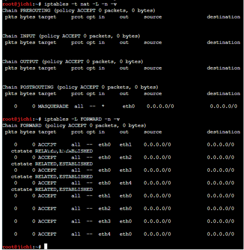
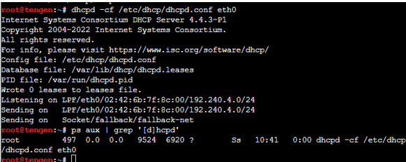
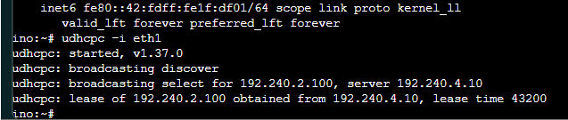
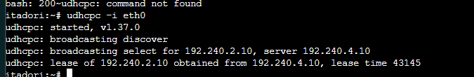
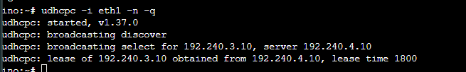
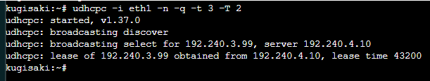
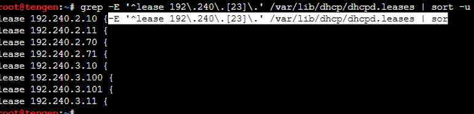
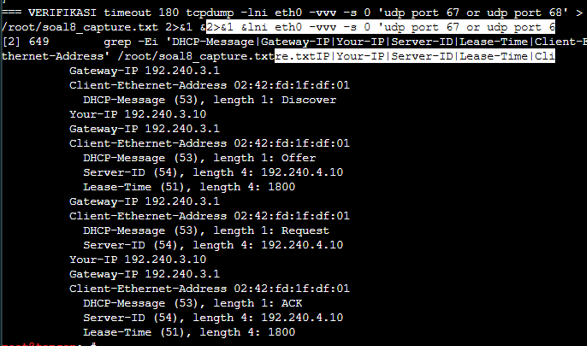
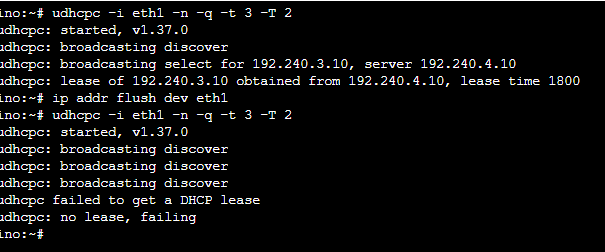
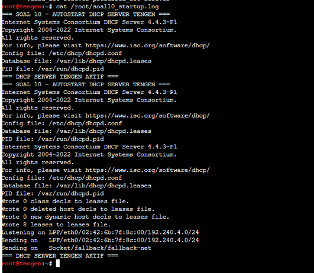

# Laporan Praktikum Jaringan Komputer — Modul 3 (K-58)

## Identitas Kelompok

| Nama | NRP |
|---|---|
| **Nadia Iqlima** | **5027251108** |
| **Muhammad Salman Rifki Haq** | **5027251097** |

Repository ini merupakan dokumentasi pengerjaan **Praktikum Jaringan Komputer Modul 3 Tahun 2026, Kelompok K-58**, khususnya **Soal 1–10**. Praktikum dilaksanakan pada lingkungan **GNS3**, menggunakan node berbasis **DebiNet** untuk router dan DHCP server serta **AlpiNet** pada sejumlah client. Fokus pekerjaan adalah konfigurasi pengalamatan IP, *routing*, DHCP server, DHCP relay, klasifikasi pool, *lease time*, reservasi IP, verifikasi konfigurasi, *packet capture*, simulasi gangguan, dan *autostart* setelah restart.

Penulisan ini mengikuti pola laporan pada [repository Modul 2 K-58](https://github.com/belaufed/Jarkom-Modul-2-2026-K-58): setiap nomor memuat tujuan, langkah pengerjaan, konfigurasi/script, hasil pengujian, analisis, dan bukti dokumentasi.

> **Catatan ruang lingkup:** Dokumentasi ini disusun dari catatan script dan bukti pengerjaan Soal 1–10. Soal 11–20 dapat ditambahkan oleh anggota kelompok yang melanjutkan pengerjaan. Nama dan IP node mengikuti **topologi akhir yang sudah dikoreksi**, bukan catatan IP pada percobaan awal.

## Daftar Isi

- [Persiapan dan Topologi](#persiapan-dan-topologi)
- [Soal 1 — Konfigurasi Router Jichi](#soal-1--konfigurasi-router-jichi)
- [Soal 2 — Konfigurasi DHCP Server Tengen](#soal-2--konfigurasi-dhcp-server-tengen)
- [Soal 3 — Konfigurasi DHCP Relay Jichi](#soal-3--konfigurasi-dhcp-relay-jichi)
- [Soal 4 — Pembagian Dua DHCP Pool Network 2](#soal-4--pembagian-dua-dhcp-pool-network-2)
- [Soal 5 — Short Lease dan Long Lease Network 3](#soal-5--short-lease-dan-long-lease-network-3)
- [Soal 6 — DHCP Reservation Kugisaki](#soal-6--dhcp-reservation-kugisaki)
- [Soal 7 — Verifikasi IP, Gateway, DNS, dan Lease](#soal-7--verifikasi-ip-gateway-dns-dan-lease)
- [Soal 8 — Capture Proses DHCP DORA](#soal-8--capture-proses-dhcp-dora)
- [Soal 9 — Simulasi Kegagalan dan Pemulihan Relay](#soal-9--simulasi-kegagalan-dan-pemulihan-relay)
- [Soal 10 — Autostart Setelah Restart](#soal-10--autostart-setelah-restart)
- [Kendala dan Penyelesaian](#kendala-dan-penyelesaian)
- [Kesimpulan](#kesimpulan)

---

## Persiapan dan Topologi

Topologi menggunakan router **Jichi** sebagai penghubung empat jaringan internal dengan jalur **NAT1** menuju jaringan luar. **Tengen** ditempatkan di Network 4 sebagai DHCP server terpusat. Permintaan alamat dari client Network 2 dan Network 3 diteruskan oleh DHCP relay pada Jichi.

### Pemetaan jaringan akhir

| Segmen | Network ID | Interface Jichi | IP Jichi | Node utama |
|---|---|---|---|---|
| WAN/NAT1 | `192.168.122.0/24` | `eth0` | `192.168.122.10/24` | NAT1 |
| Network 1 | `192.240.1.0/24` | `eth1` | `192.240.1.1/24` | Utahime, Shoko, Gojo |
| Network 2 | `192.240.2.0/24` | `eth2` | `192.240.2.1/24` | Itadori, Fushiguro, Zenin, Okkotsu |
| Network 3 | `192.240.3.0/24` | `eth3` | `192.240.3.1/24` | Ino, Kusakabe, Kugisaki, Miwa |
| Network 4 / Data Center | `192.240.4.0/24` | `eth4` | `192.240.4.1/24` | Tengen dan node Data Center lainnya |

Tengen menggunakan IP **`192.240.4.10/24`** dan default gateway **`192.240.4.1`**. Seluruh jaringan internal menggunakan subnet mask `/24` atau `255.255.255.0`.

Pada awal praktikum, beberapa node Network 2 dan Network 3 sempat tersambung ke jaringan yang tidak sesuai pembagian soal. Koneksi pada topologi kemudian disesuaikan sehingga **Network 2 berada pada Jichi `eth2`** dan **Network 3 berada pada Jichi `eth3`**. Pemetaan inilah yang dipakai dalam konfigurasi akhir.

### Kebijakan IP yang berhasil diterapkan

| Client | Interface DHCP yang dipakai | Kebijakan IP | Contoh IP hasil pengujian |
|---|---|---|---|
| Itadori | `eth0` | Pool 1 Network 2 | `192.240.2.10` |
| Fushiguro | `eth0` | Pool 1 Network 2 | `192.240.2.11` |
| Zenin | `eth0` | Pool 2 Network 2 | `192.240.2.70` |
| Okkotsu | `eth0` | Pool 2 Network 2 | `192.240.2.71` |
| Ino | `eth1` | Short lease, 1800 detik | `192.240.3.10` |
| Kusakabe | `eth0` | Short lease, 1800 detik | `192.240.3.11` |
| Miwa | `eth0` | Long lease, 43200 detik | `192.240.3.101` |
| Kugisaki | `eth1` | IP reservation | `192.240.3.99` |

> **Perhatian:** IP dari pool DHCP bersifat dinamis; tabel di atas merupakan contoh hasil pengujian, bukan pengaturan IP statis client. Khusus Kugisaki, alamat `192.240.3.99` ditetapkan melalui reservasi DHCP.

---

## Soal 1 — Konfigurasi Router Jichi

### Tujuan

Mengonfigurasi Jichi sebagai router utama yang menghubungkan NAT1 dengan Network 1 sampai Network 4, menyediakan default gateway masing-masing jaringan, mengaktifkan IPv4 forwarding, serta melakukan NAT agar jaringan internal dapat berkomunikasi menuju jaringan luar.

### Langkah Pengerjaan

1. Menghubungkan Jichi dengan NAT1 pada `eth0`, kemudian menghubungkan masing-masing network internal pada `eth1` hingga `eth4`.
2. Memberikan IP pada setiap interface menggunakan perintah `ip addr`.
3. Menetapkan default route Jichi menuju gateway NAT1 `192.168.122.1`.
4. Mengaktifkan IPv4 forwarding sehingga Jichi dapat meneruskan paket antarsubnet.
5. Menambahkan aturan `iptables` *MASQUERADE* dan *FORWARD* untuk akses keluar.
6. Menyimpan rangkaian konfigurasi sebagai script `/root/soal1_jichi.sh`, lalu melakukan pengecekan IP, tabel routing, NAT, dan konektivitas.

Perintah awal yang diterapkan pada Jichi:

```bash
ip addr add 192.168.122.10/24 dev eth0
ip addr add 192.240.1.1/24 dev eth1
ip addr add 192.240.2.1/24 dev eth2
ip addr add 192.240.3.1/24 dev eth3
ip addr add 192.240.4.1/24 dev eth4
sysctl -w net.ipv4.ip_forward=1
iptables -t nat -A POSTROUTING -o eth0 -j MASQUERADE
```

### Script `/root/soal1_jichi.sh`

```bash
#!/bin/bash

# WAN / NAT1
ip addr replace 192.168.122.10/24 dev eth0
ip link set eth0 up
ip route replace default via 192.168.122.1

echo "nameserver 192.168.122.1" > /etc/resolv.conf

# Gateway empat jaringan internal
ip addr replace 192.240.1.1/24 dev eth1
ip addr replace 192.240.2.1/24 dev eth2
ip addr replace 192.240.3.1/24 dev eth3
ip addr replace 192.240.4.1/24 dev eth4

# Aktifkan forwarding
sysctl -w net.ipv4.ip_forward=1

# Aturan NAT tanpa menambahkan duplikat
iptables -t nat -C POSTROUTING -o eth0 -j MASQUERADE 2>/dev/null || \
  iptables -t nat -A POSTROUTING -o eth0 -j MASQUERADE

# Mengizinkan lalu lintas dari jaringan internal menuju WAN
for IFACE in eth1 eth2 eth3 eth4; do
  iptables -C FORWARD -i "$IFACE" -o eth0 -j ACCEPT 2>/dev/null || \
    iptables -A FORWARD -i "$IFACE" -o eth0 -j ACCEPT
  iptables -C FORWARD -i eth0 -o "$IFACE" -m conntrack \
    --ctstate ESTABLISHED,RELATED -j ACCEPT 2>/dev/null || \
    iptables -A FORWARD -i eth0 -o "$IFACE" -m conntrack \
    --ctstate ESTABLISHED,RELATED -j ACCEPT
done

echo "=== SOAL 1 JICHI SELESAI ==="
```

**Penjelasan script:** `ip addr replace` menetapkan IP pada interface, `ip route replace` mengatur rute default, `sysctl` mengaktifkan proses penerusan paket IPv4, sedangkan `iptables` mengatur translasi alamat dan akses lalu lintas antarjaringan. Pada tahap troubleshooting, IP lama yang tertinggal di suatu interface diperiksa dan dibersihkan secara terpisah jika diperlukan karena `ip addr replace` tidak selalu menghapus seluruh alamat sekunder.

### Hasil dan Analisis

Pengecekan aturan NAT menunjukkan adanya *MASQUERADE* pada interface WAN. Pengujian awal menuju gateway lokal dan gateway NAT menunjukkan balasan ping, dan hasil praktikum akhir membuktikan Jichi dapat meneruskan komunikasi client dari Network 2 dan Network 3 menuju Tengen di Network 4.

### Bukti Dokumentasi



.png)

> **Tempat foto:** Ganti dua gambar di atas dengan screenshot IP Jichi, tabel NAT, dan hasil ping. Simpan file dengan nama yang sama di folder `bukti/soal-01/`.

---

## Soal 2 — Konfigurasi DHCP Server Tengen

### Tujuan

Mengaktifkan **ISC DHCP Server** pada node Tengen dengan IP `192.240.4.10/24` sebagai penyedia alamat IP bagi Network 2 dan Network 3 yang berada di luar subnet langsung server.

### Langkah Pengerjaan

1. Mengatur Tengen di Network 4 dengan IP `192.240.4.10/24` dan gateway `192.240.4.1`.
2. Menyiapkan direktori database lease `/var/lib/dhcp` beserta file `dhcpd.leases`.
3. Menuliskan konfigurasi awal di `/etc/dhcp/dhcpd.conf`. Network 4 didaftarkan sebagai subnet lokal tanpa range DHCP, sedangkan Network 2 dan Network 3 diberi range awal sementara.
4. Memvalidasi konfigurasi dengan `dhcpd -t` dan menjalankan DHCP Server pada `eth0`.
5. Memeriksa proses DHCP menggunakan `pgrep -af dhcpd`.

Konfigurasi awal ini **belum merupakan konfigurasi final**: rentang sementara nantinya diperbarui pada Soal 4 dan 5 sesuai aturan tiap client.

### Script `/root/soal2_tengen.sh` (konfigurasi tahap awal)

```bash
#!/bin/bash

# DHCP Server Tengen 192.240.4.10/24
mkdir -p /var/lib/dhcp
touch /var/lib/dhcp/dhcpd.leases

cat > /etc/dhcp/dhcpd.conf <<'CONF'
authoritative;

# Subnet langsung Tengen (tanpa DHCP pool)
subnet 192.240.4.0 netmask 255.255.255.0 {
}

# Pool awal sementara Network 2
subnet 192.240.2.0 netmask 255.255.255.0 {
  range 192.240.2.100 192.240.2.200;
  option subnet-mask 255.255.255.0;
  option routers 192.240.2.1;
  option domain-name-servers 192.168.122.1;
}

# Pool awal sementara Network 3
subnet 192.240.3.0 netmask 255.255.255.0 {
  range 192.240.3.100 192.240.3.200;
  option subnet-mask 255.255.255.0;
  option routers 192.240.3.1;
  option domain-name-servers 192.168.122.1;
}
CONF

dhcpd -t -cf /etc/dhcp/dhcpd.conf || exit 1
pkill -x dhcpd 2>/dev/null || true
dhcpd -cf /etc/dhcp/dhcpd.conf eth0

echo "=== SOAL 2 TENGEN SELESAI ==="
```

**Penjelasan script:** `authoritative;` menunjukkan bahwa Tengen bertindak sebagai DHCP server otoritatif pada jaringan yang dikelolanya. Konfigurasi subnet Network 2 dan 3 diperlukan agar Tengen dapat mengenali permintaan yang diteruskan relay dari jaringan yang berbeda. `dhcpd -t` memastikan sintaks konfigurasi valid sebelum layanan dijalankan.

### Hasil dan Analisis

Proses `dhcpd` dapat dijalankan pada `eth0`, sehingga Tengen siap menerima permintaan DHCP dari Jichi. Pada tahap berikutnya, pool sementara diganti menjadi pool khusus berdasarkan MAC serta durasi lease. Oleh karena itu, script awal No. 2 merupakan dokumentasi tahapan pengerjaan dan **tidak dijalankan ulang setelah konfigurasi lanjutan diterapkan**.

### Bukti Dokumentasi



> **Tempat foto:** Screenshot proses `dhcpd`, validasi `dhcpd -t`, dan konfigurasi awal Tengen.

---

## Soal 3 — Konfigurasi DHCP Relay Jichi

### Tujuan

Mengonfigurasi **DHCP Relay** pada Jichi agar permintaan DHCP broadcast dari client Network 2 dan Network 3 dapat diteruskan ke DHCP server Tengen pada Network 4.

### Langkah Pengerjaan

1. Memastikan Jichi memiliki alamat `192.240.2.1` pada `eth2`, `192.240.3.1` pada `eth3`, dan `192.240.4.1` pada `eth4`.
2. Mengaktifkan IPv4 forwarding.
3. Menjalankan `dhcrelay` dengan `eth2` dan `eth3` sebagai sisi yang menerima request client (*downstream*), sementara `eth4` menuju Tengen (*upstream*).
4. Menguji client menggunakan `udhcpc` dan memeriksa log relay.
5. Memperbaiki jalur kabel/switch ketika pengujian awal menunjukkan node Network 2 dan Network 3 berada di subnet yang tertukar.

### Script `/root/soal3_jichi.sh`

```bash
#!/bin/sh

# DHCP Relay Jichi
# Network 2: eth2
# Network 3: eth3
# Jalur server Tengen: eth4

sysctl -w net.ipv4.ip_forward=1

dhcrelay -d -4 -iu eth4 -id eth2 -id eth3 \
  192.240.4.10 > /tmp/relay.log 2>&1 &

echo "DHCP Relay aktif. Log: /tmp/relay.log"
```

Perintah `dhcrelay` pada catatan awal juga pernah dijalankan dalam mode foreground. Untuk pelaksanaan berikutnya digunakan penanda `&` dan redirection agar layanan berjalan di background dan console Jichi tetap dapat digunakan.

### Pengujian

```bash
# Jichi: memastikan relay aktif dan membaca log
pgrep -af dhcrelay
tail -n 30 /tmp/relay.log

# Contoh pada client Network 2
udhcpc -i eth0 -n -q

# Contoh pada client Network 3 (interface aktual Ino)
udhcpc -i eth1 -n -q
```

### Hasil dan Analisis

Setelah topologi dikoreksi, client Network 2 menerima IP dari jaringan `192.240.2.0/24` dan client Network 3 dari jaringan `192.240.3.0/24`. Pesan `Forwarded BOOTREQUEST` pada log relay membuktikan bahwa Jichi meneruskan permintaan ke `192.240.4.10`. Kondisi ini menunjukkan fungsi relay diperlukan karena DHCP broadcast dari client tidak dapat langsung melewati router menuju subnet server.

### Bukti Dokumentasi



.png)

> **Tempat foto:** Screenshot proses `dhcrelay`, log `Forwarded BOOTREQUEST`, dan hasil `udhcpc` client.

---

## Soal 4 — Pembagian Dua DHCP Pool Network 2

### Tujuan

Membagi alokasi alamat pada Network 2 menjadi dua pool berdasarkan MAC address client. Itadori dan Fushiguro harus memperoleh IP dari **Pool 1 `192.240.2.10–192.240.2.35`**, sedangkan Zenin dan Okkotsu dari **Pool 2 `192.240.2.70–192.240.2.95`**. Alamat pada rentang `192.240.2.36–192.240.2.69` tidak dimasukkan dalam pool.

### Langkah Pengerjaan

1. Memeriksa MAC address masing-masing client menggunakan `ip link show` atau `ip -br link`.
2. Menambahkan dua `class` pada konfigurasi ISC DHCP Tengen.
3. Mengatur dua blok `pool` di dalam subnet Network 2 dan membatasi setiap pool menggunakan `allow members of`.
4. Memvalidasi konfigurasi, menjalankan ulang server setelah memastikan proses sebelumnya berhenti, lalu menguji setiap client.
5. Mengoreksi MAC Fushiguro ketika pengecekan interface menunjukkan MAC aktual berakhiran **`e4:55:02:00`**, bukan `ef:55:02:00` sebagaimana catatan sebelumnya.

### Konfigurasi DHCP Tengen — Soal 4

**File:** `/etc/dhcp/dhcpd.conf` (bagian class berada di luar blok subnet).

```conf
# Klasifikasi client Pool 1
class "pool1" {
    match if
        hardware = 1:02:42:2f:bf:32:00 or
        hardware = 1:02:42:e4:55:02:00;
}

# Klasifikasi client Pool 2
class "pool2" {
    match if
        hardware = 1:02:42:12:48:b9:00 or
        hardware = 1:02:42:54:73:8d:00;
}

# Bagian subnet Network 2
subnet 192.240.2.0 netmask 255.255.255.0 {
    option subnet-mask 255.255.255.0;
    option routers 192.240.2.1;
    option broadcast-address 192.240.2.255;
    option domain-name-servers 192.240.1.2, 192.240.1.3;
    option domain-search "k58.com";

    pool {
        range 192.240.2.10 192.240.2.35;
        allow members of "pool1";
    }

    pool {
        range 192.240.2.70 192.240.2.95;
        allow members of "pool2";
    }
}
```

> **Catatan tahapan:** DNS dan `domain-search` pada potongan di atas merupakan **konfigurasi akhir setelah penyempurnaan Soal 7**. Pada percobaan awal Soal 4, DNS Network 2 masih `192.168.122.1`. Konfigurasi No. 4 dalam catatan praktikum dimasukkan langsung ke `dhcpd.conf`, sehingga bukan script `.sh` tersendiri yang terverifikasi.

### Pengujian dan Hasil

| Kelompok | Client | MAC yang digunakan | Contoh IP diterima |
|---|---|---|---|
| Pool 1 | Itadori | `02:42:2f:bf:32:00` | `192.240.2.10` |
| Pool 1 | Fushiguro | `02:42:e4:55:02:00` | `192.240.2.11` |
| Pool 2 | Zenin | `02:42:12:48:b9:00` | `192.240.2.70` |
| Pool 2 | Okkotsu | `02:42:54:73:8d:00` | `192.240.2.71` |

Seluruh alamat contoh berada di rentang pool yang ditentukan. Pada pengujian awal, Itadori dan Zenin lebih dahulu berhasil memperoleh `.2.10` dan `.2.70`. Setelah koreksi konfigurasi dan proses DHCP server, Fushiguro serta Okkotsu juga berhasil memperoleh lease dari kelompok masing-masing.

### Analisis

Pemisahan pool berdasarkan MAC memastikan tiap kelompok client hanya menggunakan rentang yang disediakan, walaupun keempatnya berada pada subnet fisik yang sama. Rentang larangan `.36–.69` tidak dicantumkan sebagai pool sehingga DHCP server tidak mengalokasikan alamat tersebut melalui konfigurasi ini.

### Bukti Dokumentasi



.png)

.png)

> **Tempat foto:** Hasil `udhcpc` Itadori/Fushiguro dan Zenin/Okkotsu, serta konfigurasi kedua pool.

---

## Soal 5 — Short Lease dan Long Lease Network 3

### Tujuan

Memberlakukan dua kebijakan waktu sewa IP pada Network 3: **short lease 1800 detik (30 menit)** untuk Ino dan Kusakabe dari rentang `192.240.3.10–192.240.3.89`, serta **long lease 43200 detik (12 jam)** untuk Miwa dari rentang `192.240.3.100–192.240.3.199`.

### Langkah Pengerjaan

1. Mengumpulkan MAC address pada interface client yang benar. Dalam prosesnya ditemukan bahwa Ino terhubung melalui `eth1`, sedangkan Kusakabe dan Miwa melalui `eth0`.
2. Membuat `class "short_lease"` serta `class "long_lease"` pada DHCP server Tengen.
3. Menyusun dua pool pada Network 3 yang memiliki `default-lease-time` dan `max-lease-time` sesuai ketentuan soal.
4. Menguji masing-masing client menggunakan `udhcpc` serta memeriksa DHCP server ketika awalnya client hanya menampilkan `broadcasting discover`.
5. Memperbaiki konflik IP antara Geto dan Tengen yang sebelumnya sama-sama menggunakan `192.240.4.10`, kemudian memastikan DHCP server berjalan dan menerima request dari relay.
6. Menyimpan salinan konfigurasi berhasil ke `/root/soal5_dhcpd.conf` dan membuat script pemulihannya.

### Konfigurasi class dan pool Network 3

**File:** `/etc/dhcp/dhcpd.conf`

```conf
class "short_lease" {
    match if
        hardware = 1:02:42:fd:1f:df:01 or
        hardware = 1:02:42:a1:72:8b:00;
}

class "long_lease" {
    match if
        hardware = 1:02:42:be:e7:21:00;
}

subnet 192.240.3.0 netmask 255.255.255.0 {
    option subnet-mask 255.255.255.0;
    option routers 192.240.3.1;
    option broadcast-address 192.240.3.255;
    option domain-name-servers 192.240.1.2, 192.240.1.3;
    option domain-search "k58.com";

    pool {
        range 192.240.3.10 192.240.3.89;
        default-lease-time 1800;
        max-lease-time 1800;
        allow members of "short_lease";
    }

    pool {
        range 192.240.3.100 192.240.3.199;
        default-lease-time 43200;
        max-lease-time 43200;
        allow members of "long_lease";
    }
}
```

> **Catatan:** Konfigurasi `broadcast-address` dan DNS di atas adalah versi yang telah dilengkapi pada Soal 7. Pada Soal 5, ketentuan inti yang diuji adalah klasifikasi MAC, rentang pool, dan durasi lease.

### Script `/root/soal5_tengen.sh`

```bash
#!/bin/sh

echo "=== KONFIGURASI DHCP SOAL 5 - TENGEN ==="

# Mengembalikan snapshot konfigurasi Soal 5
cp /root/soal5_dhcpd.conf /etc/dhcp/dhcpd.conf

mkdir -p /var/lib/dhcp
touch /var/lib/dhcp/dhcpd.leases

dhcpd -t -cf /etc/dhcp/dhcpd.conf || exit 1

pkill -x dhcpd 2>/dev/null || true
sleep 1

dhcpd -cf /etc/dhcp/dhcpd.conf eth0

echo "=== SOAL 5 TENGEN SELESAI ==="
```

### Hasil dan Analisis

| Client | Interface | IP hasil uji | Lease time | Kebijakan |
|---|---|---|---|---|
| Ino | `eth1` | `192.240.3.10` | `1800` detik | Short lease |
| Kusakabe | `eth0` | `192.240.3.11` | `1800` detik | Short lease |
| Miwa | `eth0` | `192.240.3.101` | `43200` detik | Long lease |

Pada awal percobaan, ketiga client mengalami kesulitan karena antarmuka dan MAC yang digunakan untuk mengirim DHCP request belum semuanya sesuai. Debugging menggunakan `ip link`, `arping`, `tcpdump`, dan log `dhcpd` menunjukkan bahwa permintaan dapat diteruskan Jichi, tetapi server belum selalu membalas. Selain kesalahan pemilihan interface, ditemukan **duplikasi IP Tengen `192.240.4.10` pada Geto**. Setelah IP yang bentrok dihapus dari Geto dan layanan DHCP server yang aktif diperiksa/dijalankan ulang dengan konfigurasi benar, Kusakabe serta Miwa berhasil menerima lease. Perbedaan durasi telah sesuai dengan kebijakan masing-masing client.

**Catatan penting:** Snapshot No. 5 menggambarkan keadaan pada saat Soal 5 selesai. Menjalankan ulang script ini setelah mengerjakan Soal 6 dan seterusnya dapat menimpa perubahan lanjutan.

### Bukti Dokumentasi



.png)

.png)

> **Tempat foto:** Screenshot Ino dan Kusakabe yang mendapat lease 1800 detik, serta Miwa dengan lease 43200 detik.

---

## Soal 6 — DHCP Reservation Kugisaki

### Tujuan

Memastikan node Kugisaki memperoleh **IP tetap `192.240.3.99` melalui DHCP reservation**. Alamat tersebut dipilih di luar rentang short lease (`.10–.89`) dan long lease (`.100–.199`) agar tidak bertabrakan dengan pool dinamis.

### Langkah Pengerjaan

1. Memeriksa interface dan MAC address Kugisaki menggunakan `ip -br link`.
2. Menguji hubungan ke gateway Network 3. Pengujian menunjukkan jalur yang benar berada pada **`eth1`** dengan MAC **`02:42:30:5d:bd:01`**.
3. Menambahkan deklarasi `host kugisaki` ke file `/etc/dhcp/dhcpd.conf` pada Tengen.
4. Memvalidasi dan mengaktifkan ulang DHCP server setelah memastikan proses sebelumnya tidak berbenturan.
5. Meminta lease dari Kugisaki, memeriksa hasil IP yang diterima, lalu menyimpan snapshot konfigurasi No. 6.

### Konfigurasi reservation Kugisaki

```conf
# SOAL 6 — Fixed DHCP reservation
host kugisaki {
    hardware ethernet 02:42:30:5d:bd:01;
    fixed-address 192.240.3.99;
}
```

### Script `/root/soal6_tengen.sh`

```bash
#!/bin/sh
set -e

echo "=== KONFIGURASI DHCP SOAL 6 - TENGEN ==="

cp /root/soal6_dhcpd.conf /etc/dhcp/dhcpd.conf
mkdir -p /var/lib/dhcp
touch /var/lib/dhcp/dhcpd.leases

dhcpd -t -cf /etc/dhcp/dhcpd.conf

pkill -x dhcpd 2>/dev/null || true
sleep 1

dhcpd -cf /etc/dhcp/dhcpd.conf eth0

echo "=== SOAL 6 TENGEN SELESAI ==="
```

### Hasil dan Analisis

Pada Kugisaki dijalankan:

```bash
udhcpc -i eth1 -n -q -t 3 -T 2
```

Client berhasil mendapatkan **`192.240.3.99` dari DHCP Server `192.240.4.10`**. Hasil yang terlihat menunjukkan lease time `43200` detik; nilai ini tidak menjadi masalah karena kriteria utama Soal 6 adalah IP reservation, bukan durasi lease tertentu. Reservasi memastikan alamat tersebut hanya diperuntukkan bagi MAC Kugisaki pada konfigurasi server.

### Bukti Dokumentasi




> **Tempat foto:** Screenshot `udhcpc` Kugisaki dan blok `host kugisaki` pada Tengen.

---

## Soal 7 — Verifikasi IP, Gateway, DNS, dan Lease

### Tujuan

Memeriksa kesesuaian konfigurasi seluruh client Network 2 dan 3: subnet mask `/24`, gateway dan broadcast sesuai subnet, DNS `192.240.1.2` serta `192.240.1.3`, *domain-search* yang ditentukan, dan catatan alamat dalam file `/var/lib/dhcp/dhcpd.leases` milik Tengen. Pemeriksaan juga memastikan alamat hasil alokasi tidak melewati kebijakan pool.

### Langkah Pengerjaan

1. Memperbarui DHCP options pada konfigurasi Tengen. Network 2 sebelumnya masih menggunakan DNS `192.168.122.1`, kemudian diganti menjadi `192.240.1.2` dan `192.240.1.3`.
2. Menambahkan `option broadcast-address` pada Network 2 dan Network 3 serta menerapkan `option domain-search "k58.com"` yang digunakan selama pengerjaan.
3. Melakukan validasi dan memastikan server berjalan dengan konfigurasi terbaru.
4. Memperbarui DHCP lease secara berurutan pada Ino, Kusakabe, Miwa, Kugisaki, Itadori, Fushiguro, Zenin, dan Okkotsu.
5. Memeriksa alamat IP, routing, dan konfigurasi resolver client, lalu mencocokkan catatan lease pada Tengen.

### Konfigurasi DHCP options

```conf
# Network 2
option subnet-mask 255.255.255.0;
option routers 192.240.2.1;
option broadcast-address 192.240.2.255;
option domain-name-servers 192.240.1.2, 192.240.1.3;
option domain-search "k58.com";

# Network 3
option subnet-mask 255.255.255.0;
option routers 192.240.3.1;
option broadcast-address 192.240.3.255;
option domain-name-servers 192.240.1.2, 192.240.1.3;
option domain-search "k58.com";
```

Blok option di atas diletakkan **di dalam blok `subnet` masing-masing**. Pengaturan pool pada Soal 4, short/long lease pada Soal 5, serta reservation pada Soal 6 tetap dipertahankan.

### Perintah verifikasi pada client

```bash
# Contoh Ino (Network 3)
udhcpc -i eth1 -n -q -t 3 -T 2
ip -4 addr show eth1
ip route
cat /etc/resolv.conf

# Contoh Itadori (Network 2)
udhcpc -i eth0 -n -q -t 3 -T 2
ip -4 addr show eth0
ip route
cat /etc/resolv.conf
```

### Script `/root/soal7_tengen.sh`

```bash
#!/bin/sh

echo "=== VERIFIKASI DHCP SOAL 7 ==="

echo "=== VALIDASI KONFIGURASI ==="
dhcpd -t -cf /etc/dhcp/dhcpd.conf || exit 1

echo "=== DHCP OPTIONS ==="
grep -E 'option (subnet-mask|routers|broadcast-address|domain-name-servers|domain-search)' \
    /etc/dhcp/dhcpd.conf

echo "=== DAFTAR LEASE NETWORK 2 DAN 3 ==="
grep -E '^lease 192\.240\.[23]\.' /var/lib/dhcp/dhcpd.leases | sort -u

echo "=== RESERVATION KUGISAKI ==="
grep -A3 '^host kugisaki' /etc/dhcp/dhcpd.conf

echo "=== VERIFIKASI SOAL 7 SELESAI ==="
```

### Hasil dan Analisis

Dari pemeriksaan client, Ino dan Kusakabe telah menunjukkan IP `/24`, broadcast `192.240.3.255`, gateway `192.240.3.1`, serta dua DNS yang diminta. Itadori juga menunjukkan IP `192.240.2.10/24`, broadcast `192.240.2.255`, gateway `192.240.2.1`, dan dua DNS tersebut. Pemeriksaan terhadap Miwa, Kugisaki, Fushiguro, Zenin, dan Okkotsu dilanjutkan dan dilaporkan berhasil pada console praktikum.

Pada Tengen dijalankan:

```bash
grep -E '^lease 192\.240\.[23]\.' /var/lib/dhcp/dhcpd.leases | sort -u
```

Catatan lease yang muncul antara lain:

```text
lease 192.240.2.10 {
lease 192.240.2.11 {
lease 192.240.2.70 {
lease 192.240.2.71 {
lease 192.240.3.10 {
lease 192.240.3.100 {
lease 192.240.3.101 {
lease 192.240.3.11 {
```

Alamat pada daftar berada di dalam rentang pool yang digunakan. IP Kugisaki `.3.99` tidak wajib terlihat sebagai entri lease dinamis karena menggunakan *fixed reservation*. Daftar `grep` tersebut juga dapat mencakup histori lease, sehingga pengecekan status aktif dan bentrok IP tidak boleh hanya mengandalkan daftar ini.

**Catatan verifikasi:** Dua alamat DNS telah terlihat pada `/etc/resolv.conf` sejumlah client. Namun, pada screenshot yang didokumentasikan, `search k58.com` **belum tampak** di `resolv.conf`. Opsi `domain-search` telah dikonfigurasi di server, tetapi penerapannya oleh script DHCP client perlu diverifikasi terpisah apabila menjadi aspek penilaian.

### Bukti Dokumentasi



> **Tempat foto:** Screenshot IP/routing/resolver client dan output lease pada Tengen; dapat ditambah screenshot per client sesuai kebutuhan laporan.

---

## Soal 8 — Capture Proses DHCP DORA

### Tujuan

Merekam pertukaran paket **DHCPDISCOVER → DHCPOFFER → DHCPREQUEST → DHCPACK (DORA)** menggunakan `tcpdump`, kemudian mengidentifikasi alamat server, IP yang ditawarkan, lease time, dan field `giaddr` yang diisi DHCP relay.

### Langkah Pengerjaan

1. Memilih Ino sebagai client Network 3 karena interface aktifnya telah diketahui, yaitu `eth1`.
2. Menjalankan `tcpdump` pada Tengen `eth0` untuk merekam lalu lintas DHCP UDP port 67/68.
3. Menjalankan ulang permintaan `udhcpc` dari Ino saat capture aktif.
4. Menyaring output untuk menampilkan field `DHCP-Message`, `Gateway-IP`, `Your-IP`, `Server-ID`, dan `Lease-Time`.
5. Menyimpan hasil capture dan screenshot urutan DORA sebagai bukti.

### Script `/root/soal8_tengen.sh`

```bash
#!/bin/sh

echo "=== SOAL 8 - PACKET CAPTURE DHCP ==="

timeout 180 tcpdump -lni eth0 -vvv -s 0 \
  'udp port 67 or udp port 68' \
  > /root/soal8_capture_ulang.txt 2>&1 &

echo "Packet capture aktif selama 180 detik."
echo "Lakukan DHCP request dari client Network 2 atau 3."
echo "Contoh Ino: udhcpc -i eth1 -n -q"
echo "Setelah berhasil, periksa hasil dengan:"
echo "grep -Ei 'DHCP-Message|Gateway-IP|Your-IP|Server-ID|Lease-Time' /root/soal8_capture_ulang.txt"
echo "=== SOAL 8 SIAP ==="
```

Pada pengujian sebenarnya, capture pertama disimpan pada `/root/soal8_capture.txt`. Script di atas menggunakan nama `_ulang.txt` agar hasil awal tidak tertimpa bila demonstrasi dilakukan kembali.

### Hasil Capture

| Tahap | Temuan |
|---|---|
| **DHCPDISCOVER** | Ino mengirim permintaan IP melalui relay Jichi. |
| **DHCPOFFER** | Tengen menawarkan `192.240.3.10`. |
| **DHCPREQUEST** | Client meminta IP yang ditawarkan tersebut. |
| **DHCPACK** | Tengen menyetujui lease `192.240.3.10`. |

Field penting yang terlihat pada capture:

| Field | Hasil |
|---|---|
| DHCP Server / Server-ID | `192.240.4.10` |
| IP yang diberikan / Your-IP | `192.240.3.10` |
| Lease-Time | `1800` detik |
| `giaddr` / Gateway-IP | `192.240.3.1` |
| MAC client Ino | `02:42:fd:1f:df:01` |

### Analisis

`giaddr = 192.240.3.1` sesuai dengan IP interface Jichi `eth3`, yaitu interface yang menerima request dari Network 3. Hal ini membuktikan relay meneruskan request ke Tengen sambil menyediakan informasi asal subnet agar server dapat memilih pool yang tepat. Urutan DORA lengkap berhasil ditampilkan pada capture.

### Bukti Dokumentasi



> **Tempat foto:** Screenshot `tcpdump` yang menunjukkan Discover, Offer, Request, ACK beserta `giaddr`, serta output client Ino.

---

## Soal 9 — Simulasi Kegagalan dan Pemulihan Relay

### Tujuan

Membuktikan bahwa ketika DHCP Relay pada Jichi berhenti, client Network 2/3 tidak dapat memperoleh lease baru dari Tengen. Setelah relay dipulihkan, client harus kembali menerima alamat dari pool dan default gateway yang benar.

### Langkah Pengerjaan

1. Menghentikan relay Jichi menggunakan `pkill -x dhcrelay`.
2. Memastikan proses relay sudah tidak berjalan.
3. Pada Ino, menghapus IP lama dari `eth1` agar permintaan berikutnya benar-benar membutuhkan DHCP.
4. Menjalankan `udhcpc` dan mencatat pesan kegagalan `no lease, failing`.
5. Menyalakan relay kembali pada Jichi dan memeriksa prosesnya.
6. Mengulangi DHCP pada Ino, kemudian memeriksa IP dan gateway yang diperoleh setelah pemulihan.

### Script `/root/soal9_jichi.sh`

```bash
#!/bin/sh

echo "=== SOAL 9 - SIMULASI GANGGUAN DHCP RELAY ==="

case "$1" in
  stop)
    echo "Menghentikan DHCP Relay..."
    pkill -x dhcrelay 2>/dev/null || true
    echo "DHCP Relay dihentikan."
    ;;

  start)
    echo "Memulihkan DHCP Relay..."
    if pgrep -x dhcrelay >/dev/null; then
      echo "DHCP Relay sudah aktif."
    else
      dhcrelay -d -4 -iu eth4 -id eth2 -id eth3 \
        192.240.4.10 > /tmp/relay.log 2>&1 &
      sleep 1

      if pgrep -x dhcrelay >/dev/null; then
        echo "DHCP Relay berhasil dipulihkan."
      else
        echo "Gagal menjalankan DHCP Relay."
        tail -n 10 /tmp/relay.log
        exit 1
      fi
    fi
    ;;

  status)
    if pgrep -af dhcrelay; then
      echo "DHCP Relay AKTIF."
    else
      echo "DHCP Relay TIDAK AKTIF."
    fi
    ;;

  *)
    echo "Penggunaan:"
    echo "sh /root/soal9_jichi.sh stop"
    echo "sh /root/soal9_jichi.sh start"
    echo "sh /root/soal9_jichi.sh status"
    ;;
esac

echo "=== SOAL 9 SELESAI ==="
```

### Pengujian kegagalan dan pemulihan

```bash
# Di Jichi: mematikan relay
sh /root/soal9_jichi.sh stop

# Di Ino: menghapus IP lama dan meminta lease baru
ip addr flush dev eth1
udhcpc -i eth1 -n -q -t 3 -T 2

# Di Jichi: mengaktifkan lagi relay
sh /root/soal9_jichi.sh start

# Di Ino: menguji ulang
udhcpc -i eth1 -n -q -t 3 -T 2
ip route
```

### Hasil dan Analisis

Saat relay dimatikan, Ino menampilkan beberapa pesan `broadcasting discover`, diikuti **`failed to get a DHCP lease`** dan **`no lease, failing`**. Setelah relay dipulihkan, Ino kembali mendapatkan IP **`192.240.3.10` dari `192.240.4.10`** dengan default gateway **`192.240.3.1`**. Lease time saat pemulihan tercatat `1366` detik, yang dapat merupakan sisa lease sebelumnya.

Pengujian ini menunjukkan bahwa komunikasi DHCP lintas subnet bergantung pada relay; ketika relay berhenti, request broadcast client tidak diteruskan ke server Data Center. Ketika relay kembali berjalan, proses alokasi berfungsi lagi.

### Bukti Dokumentasi



.png)

> **Tempat foto:** Dua bukti harus memperlihatkan perbedaan jelas antara kegagalan memperoleh lease dan keberhasilan setelah relay aktif kembali.

---

## Soal 10 — Autostart Setelah Restart

### Tujuan

Memastikan konfigurasi jaringan dan layanan **DHCP Server Tengen** serta **DHCP Relay Jichi** otomatis kembali aktif setelah kedua node direstart. Setelah pemulihan, Pool 1, Pool 2, short lease, long lease, fixed reservation, gateway, dan konektivitas antarjaringan harus tetap berlaku.

### Langkah Pengerjaan

1. Mengidentifikasi proses startup node. Hasil `ps -p 1 -o pid,comm,args` menunjukkan kedua node memakai `dumb-init` yang menjalankan `/etc/debinet-init.sh`.
2. Memeriksa isi `/etc/debinet-init.sh` dan menemukan perintah yang otomatis memanggil `/root/init.sh` apabila file tersebut tersedia serta dapat dieksekusi.
3. Menyimpan konfigurasi final Tengen ke `/root/soal10_dhcpd.conf`.
4. Membuat `/root/soal10_tengen.sh` untuk memulihkan IP, routing, konfigurasi, dan DHCP Server.
5. Membuat `/root/soal10_jichi.sh` untuk memulihkan IP tiap interface, NAT, IP forwarding, dan DHCP Relay.
6. Membuat `/root/init.sh` pada **masing-masing node** untuk memanggil script No. 10 secara otomatis saat startup.
7. Melakukan uji manual script terlebih dahulu, lalu melakukan **Stop → Start** Tengen dan Jichi di GNS3.
8. Memastikan service berjalan **tanpa menjalankan script manual setelah restart**, kemudian menguji kembali DHCP dan ping dari Network 2 dan 3.

### Script `/root/soal10_tengen.sh`

```bash
#!/bin/sh
set -e

echo "=== SOAL 10 - AUTOSTART DHCP SERVER TENGEN ==="

# Mengaktifkan interface dan IP Tengen
ip link set eth0 up
ip -4 addr show eth0 | grep -q 'inet 192.240.4.10/24' || \
  ip addr add 192.240.4.10/24 dev eth0

# Gateway menuju router Jichi
ip route replace default via 192.240.4.1 dev eth0

# Memulihkan konfigurasi DHCP final
cp /root/soal10_dhcpd.conf /etc/dhcp/dhcpd.conf

# Menyiapkan database lease
mkdir -p /var/lib/dhcp
touch /var/lib/dhcp/dhcpd.leases

dhcpd -t -cf /etc/dhcp/dhcpd.conf

# Menjalankan server jika belum aktif
if ! pgrep -x dhcpd >/dev/null; then
  rm -f /var/run/dhcpd.pid
  dhcpd -cf /etc/dhcp/dhcpd.conf eth0
fi

echo "=== DHCP SERVER TENGEN AKTIF ==="
```

### Script `/root/soal10_jichi.sh`

```bash
#!/bin/sh
set -e

echo "=== SOAL 10 - AUTOSTART DHCP RELAY JICHI ==="

# Menyalakan seluruh interface
for iface in eth0 eth1 eth2 eth3 eth4; do
  ip link set "$iface" up
done

# Memastikan IP setiap interface sesuai topologi
ip -4 addr show eth0 | grep -q '192.168.122.10/24' || \
  ip addr add 192.168.122.10/24 dev eth0
ip -4 addr show eth1 | grep -q '192.240.1.1/24' || \
  ip addr add 192.240.1.1/24 dev eth1
ip -4 addr show eth2 | grep -q '192.240.2.1/24' || \
  ip addr add 192.240.2.1/24 dev eth2
ip -4 addr show eth3 | grep -q '192.240.3.1/24' || \
  ip addr add 192.240.3.1/24 dev eth3
ip -4 addr show eth4 | grep -q '192.240.4.1/24' || \
  ip addr add 192.240.4.1/24 dev eth4

# Routing, forwarding, dan NAT
ip route replace default via 192.168.122.1 dev eth0
echo 1 > /proc/sys/net/ipv4/ip_forward
iptables -t nat -C POSTROUTING -o eth0 -j MASQUERADE 2>/dev/null || \
  iptables -t nat -A POSTROUTING -o eth0 -j MASQUERADE

# Menjalankan relay jika belum aktif
if ! pgrep -x dhcrelay >/dev/null 2>&1; then
  dhcrelay -d -4 -iu eth4 -id eth2 -id eth3 \
    192.240.4.10 > /tmp/relay.log 2>&1 &
fi

echo "=== DHCP RELAY JICHI AKTIF ==="
```

### Script pemanggil autostart `/root/init.sh`

**Pada Tengen:**

```bash
#!/bin/sh

# Memulai DHCP Server otomatis
/root/soal10_tengen.sh >> /root/soal10_startup.log 2>&1
```

**Pada Jichi:**

```bash
#!/bin/sh

# Memulai DHCP Relay otomatis
/root/soal10_jichi.sh >> /root/soal10_startup.log 2>&1
```

File script diberi izin eksekusi dengan `chmod 755`. Mekanisme startup bekerja karena `/etc/debinet-init.sh` memanggil `/root/init.sh` ketika node dinyalakan.

### Pengujian setelah restart

Pada **Tengen** dilakukan:

```bash
pgrep -af dhcpd
ip -4 addr show eth0
cat /root/soal10_startup.log
```

Hasil menunjukkan proses `dhcpd` aktif otomatis, `eth0` tetap memakai `192.240.4.10/24`, dan log memuat pesan `DHCP SERVER TENGEN AKTIF`.

Pada **Jichi** dilakukan:

```bash
pgrep -af dhcrelay
ip -br addr
cat /root/soal10_startup.log
```

Hasil menunjukkan `dhcrelay` aktif otomatis serta alamat `eth0–eth4` sesuai topologi. Setelah itu, kebijakan DHCP diverifikasi dari beberapa client: Itadori (Pool 1), Zenin (Pool 2), Ino (short lease), Miwa (long lease), dan Kugisaki (IP reservation). Semua pengujian tersebut dilaporkan berhasil.

Untuk memvalidasi konektivitas lintas subnet, dilakukan:

```bash
# Itadori (Network 2)
ping -c 3 192.240.2.1
ping -c 3 192.240.4.10

# Ino (Network 3)
ping -c 3 192.240.3.1
ping -c 3 192.240.4.10
```

Ping menuju gateway dan server DHCP mendapat balasan, termasuk pengujian Itadori ke `192.240.2.1` dan `192.240.4.10`, serta Ino ke `192.240.3.1` dan `192.240.4.10`.

### Hasil dan Analisis

Uji **Stop → Start** memperlihatkan bahwa layanan tidak perlu diaktifkan secara manual setelah node menyala kembali. Pengaturan IP, DHCP pool, masa sewa, dan reservasi masih dapat digunakan sehingga tujuan pemulihan layanan setelah restart tercapai. Penggunaan `/root/init.sh` sesuai dengan mekanisme startup container yang digunakan di GNS3 pada praktikum ini.

### Bukti Dokumentasi



.png)

.png)

> **Tempat foto:** Bukti proses dan log setelah restart kedua node, hasil DHCP Network 2 dan 3, serta ping ke gateway dan Tengen.

---

## Kendala dan Penyelesaian

Selama pengerjaan praktikum terdapat beberapa kendala yang memerlukan troubleshooting bertahap:

| Kendala | Analisis | Tindakan penyelesaian |
|---|---|---|
| Client memperoleh IP dari network yang berbeda | Jalur fisik/switch pada percobaan awal belum sesuai pemetaan Network 2 dan 3 | Menyesuaikan koneksi switch ke Jichi `eth2` dan `eth3`, kemudian memeriksa alamat interface |
| Client terus menampilkan `broadcasting discover` | DHCP request bisa berasal dari interface yang salah, MAC tidak cocok dengan class, relay belum aktif, atau server belum membalas | Menggunakan `ip link`, `arping`, `pgrep`, `/tmp/relay.log`, dan `tcpdump` untuk mengisolasi masalah |
| MAC Fushiguro tidak cocok dengan class | MAC pada catatan awal berbeda dari keluaran `ip -br link` client | Memperbaiki ke `02:42:e4:55:02:00` dan memuat ulang konfigurasi DHCP |
| IP `192.240.4.10` terduplikasi | Geto dan Tengen sempat memakai alamat yang sama | Menghapus alamat duplikat dari Geto, membersihkan ARP/neighbor cache pada Jichi, dan memastikan hanya MAC Tengen merespons |
| `There's already a DHCP server running` | Terdapat proses DHCP aktif atau PID file lama, sehingga server baru tidak dapat diluncurkan | Memeriksa `pgrep -af dhcpd`, menghentikan proses lama jika perlu, lalu mengaktifkan satu instance server yang valid |
| Penentuan interface client salah | Tidak semua client menggunakan interface `eth0` sebagai koneksi aktif ke jaringan | Menguji `arping` ke gateway dan menyesuaikan MAC serta interface DHCP pada setiap client |
| Relay mati saat simulasi | DHCP broadcast tidak diteruskan ke Tengen | Mengaktifkan kembali `dhcrelay`, lalu membuktikan client dapat memperoleh lease dan default gateway semula |
| Layanan perlu aktif kembali setelah restart | Node DebiNet menggunakan mekanisme startup yang berbeda dengan `systemd` | Membuat `/root/init.sh` yang memanggil script autostart DHCP server atau relay |

**Catatan untuk pengerjaan lanjutan:** Pada akhir troubleshooting, IP duplikat `192.240.4.10` telah dihapus dari Geto, tetapi **alamat pengganti Geto belum dicatat sebagai final**. Script Geto lama yang masih dapat menetapkan IP tersebut perlu diperiksa/diperbaiki sebelum dijalankan kembali. Begitu pula script snapshot Soal 2, 5, dan 6 tidak seharusnya dijalankan setelah konfigurasi akhir tanpa mempertimbangkan dampak penimpaan `dhcpd.conf`.

## Kesimpulan

Pengerjaan Praktikum Jaringan Komputer Modul 3 Soal 1–10 berhasil membangun mekanisme pengalamatan IP terpusat menggunakan DHCP Server Tengen dan DHCP Relay Jichi pada topologi GNS3. Jichi menghubungkan beberapa subnet sekaligus menjalankan forwarding dan NAT, sedangkan Tengen memberikan alamat IP untuk Network 2 dan Network 3 sesuai klasifikasi dan kebijakan masing-masing client.

Pembagian dua DHCP pool pada Network 2, short dan long lease pada Network 3, serta IP reservation Kugisaki berhasil diuji. Pemeriksaan client menunjukkan gateway, subnet, broadcast, dan DNS yang sesuai dengan konfigurasi yang diterapkan. Capture DHCP membuktikan proses DORA lengkap serta nilai `giaddr` yang sesuai interface relay. Uji gangguan menunjukkan client gagal meminta lease baru saat relay mati, kemudian kembali berhasil setelah layanan dipulihkan.

Pada tahap akhir, pengaturan autostart berhasil diterapkan pada Tengen dan Jichi. Setelah kedua node dihentikan dan dinyalakan ulang, DHCP Server serta DHCP Relay otomatis aktif dan client tetap dapat memperoleh IP dari kebijakan yang sesuai. Pengujian ping juga mengonfirmasi komunikasi menuju gateway dan server DHCP Data Center berjalan. Dengan demikian, tujuan Soal 1–10 telah dipenuhi berdasarkan pengujian yang terdokumentasi.

---

## Penyelesaian Tugas (Nomor 11 - 20)

### 11. Konfigurasi DNS Master (Utahime)
Node Utahime bertindak sebagai pusat resolusi domain `jujutsu.k58.com`.
**Script (`soal11_master.sh`):**
```bash
#!/bin/bash
# Set IP dan DNS Sementara
ip addr flush dev eth0
ip addr add 192.240.1.10/24 dev eth0
ip link set eth0 up
ip route add default via 192.240.1.1
echo "nameserver 8.8.8.8" > /etc/resolv.conf

# Instalasi BIND9
apt-get update
apt-get install -y bind9 bind9utils bind9-doc dnsutils

# Konfigurasi Options
cat > /etc/bind/named.conf.options << 'OPT'
options {
        directory "/var/cache/bind";
        forwarders { 192.168.122.1; };
        allow-query { any; };
        auth-nxdomain no;
        listen-on-v6 { any; };
};
OPT

# Konfigurasi Zone Master
cat > /etc/bind/named.conf.local << 'LOC'
zone "jujutsu.k58.com" {
        type master;
        file "/etc/bind/db.jujutsu.k58.com";
        allow-transfer { 192.240.1.11; };
        notify yes;
};
LOC

# File Zone Database
cat > /etc/bind/db.jujutsu.k58.com << 'ZONE'
$TTL    604800
@       IN      SOA     utahime.jujutsu.k58.com. root.jujutsu.k58.com. (
                              2026101501 ; Serial
                              604800     ; Refresh
                              86400      ; Retry
                              2419200    ; Expire
                              604800 )   ; Negative Cache TTL
;
@       IN      NS      utahime.jujutsu.k58.com.
@       IN      NS      shoko.jujutsu.k58.com.
@       IN      A       192.240.1.12
utahime IN      A       192.240.1.10
shoko   IN      A       192.240.1.11
gojo    IN      A       192.240.1.12
ZONE

# Menyalakan Service
named
echo "nameserver 192.240.1.10" > /etc/resolv.conf
```
* **Cara Pengujian:** Jalankan `ps aux | grep named` untuk memastikan service berjalan.

---

### 12. Konfigurasi DNS Slave (Shoko)
Shoko berfungsi sebagai DNS cadangan yang menarik file *zone* secara otomatis dari Utahime.
**Script (`soal12_slave.sh`):**
```bash
#!/bin/bash
ip addr flush dev eth0
ip addr add 192.240.1.11/24 dev eth0
ip link set eth0 up
ip route add default via 192.240.1.1
echo "nameserver 8.8.8.8" > /etc/resolv.conf

apt-get update
apt-get install -y bind9 bind9utils bind9-doc dnsutils

cat > /etc/bind/named.conf.options << 'OPT'
options {
         directory "/var/cache/bind";
         forwarders { 192.168.122.1; };
         allow-query { any; };
         auth-nxdomain no;
         listen-on-v6 { any; };
};
OPT

cat > /etc/bind/named.conf.local << 'LOC'
zone "jujutsu.k58.com" {
         type slave;
         file "/var/cache/bind/db.jujutsu.k58.com";
         masters { 192.240.1.10; };
};
LOC

pkill named 2>/dev/null
named
echo "nameserver 192.240.1.10" > /etc/resolv.conf
```
* **Cara Pengujian:** Cek file yang ditarik menggunakan `ls -l /var/cache/bind/db.jujutsu.k58.com`.

---

### 13. Replikasi Database MariaDB (Yaga & Inumaki)
Yaga di-set sebagai *Master* dan Inumaki sebagai *Slave* untuk sinkronisasi data SQL.
**Script Yaga (Master):**
```bash
#!/bin/bash
ip addr add 192.240.4.20/24 dev eth0; ip link set eth0 up; ip route add default via 192.240.4.1
echo "nameserver 8.8.8.8" > /etc/resolv.conf

apt-get update; apt-get install -y mariadb-server
sed -i 's/bind-address.*/bind-address = 0.0.0.0/' /etc/mysql/mariadb.conf.d/50-server.cnf
sed -i '/\[mysqld\]/a server-id = 1\nlog_bin = /var/log/mysql/mysql-bin.log' /etc/mysql/mariadb.conf.d/50-server.cnf

mkdir -p /var/log/mysql; chown -R mysql:mysql /var/log/mysql
service mariadb start || service mysql start

mysql -u root -e "CREATE USER 'replica'@'%' IDENTIFIED BY 'password';"
mysql -u root -e "GRANT REPLICATION SLAVE ON *.* TO 'replica'@'%';"
mysql -u root -e "FLUSH PRIVILEGES;"
mysql -u root -e "SHOW MASTER STATUS;"
```
*(Catat nama file dan log position yang muncul untuk dimasukkan ke Inumaki).*

**Script Inumaki (Slave):**
```bash
#!/bin/bash
ip addr add 192.240.4.21/24 dev eth0; ip link set eth0 up; ip route add default via 192.240.4.1
echo "nameserver 8.8.8.8" > /etc/resolv.conf

apt-get update; apt-get install -y mariadb-server
sed -i 's/bind-address.*/bind-address = 0.0.0.0/' /etc/mysql/mariadb.conf.d/50-server.cnf
sed -i '/\[mysqld\]/a server-id = 2\nlog_bin = /var/log/mysql/mysql-bin.log' /etc/mysql/mariadb.conf.d/50-server.cnf

mkdir -p /var/log/mysql; chown -R mysql:mysql /var/log/mysql
service mariadb start || service mysql start

# Ganti nilai log file dan log pos sesuai hasil dari Yaga
mysql -u root -e "CHANGE MASTER TO MASTER_HOST='192.240.4.20', MASTER_USER='replica', MASTER_PASSWORD='password', MASTER_LOG_FILE='mysql-bin.000001', MASTER_LOG_POS=1528;"
mysql -u root -e "START SLAVE;"
mysql -u root -e "SHOW SLAVE STATUS\G"
```
* **Cara Pengujian:** Pastikan `Slave_IO_Running: Yes` dan `Slave_SQL_Running: Yes` muncul di Inumaki.

---

### 14, 15, & 18. Web Frontend, API, dan Target Load Balancing
Pendelegasian *script* untuk mengaktifkan node-node pekerja di bagian belakang (seperti Nanami, Maki, dkk) dan menyiapkan algoritma perataan beban (*Load Balancing*).
**Script (Dijalankan di masing-masing node pekerja backend):**
```bash
#!/bin/bash
ip addr flush dev eth0
# Ganti dengan IP Node masing-masing
ip addr add 192.240.x.x/24 dev eth0 
ip link set eth0 up
ip route add default via 192.240.x.1
echo "nameserver 8.8.8.8" > /etc/resolv.conf

apt-get update
apt-get install -y nginx php-fpm php-common

PHP_SVC=$(ls /etc/init.d/ | grep fpm | head -n 1)
service $PHP_SVC start

cat > /etc/nginx/sites-available/default << NGINX
server {
    listen 80 default_server;
    root /var/www/html;
    index index.php index.html index.htm;
    server_name _;
    location / {
        try_files \$uri \$uri/ =404;
    }
    location ~ \.php\$ {
        include snippets/fastcgi-php.conf;
        fastcgi_pass unix:/run/php/$PHP_SVC.sock;
    }
}
NGINX

echo "<?php echo '<h1>Selamat Datang di Node: ' . gethostname() . '</h1>'; ?>" > /var/www/html/index.php
service nginx restart
service $PHP_SVC restart
```
* **Cara Pengujian:** Jalankan `curl http://localhost` pada setiap node untuk memastikan output HTML muncul.

---

### 16, 17, & 19. Reverse Proxy, Caching, dan Rate Limiting (Gojo)
Konfigurasi Nginx di gerbang utama (Gojo) yang bertindak sebagai Reverse Proxy, menyimpan hasil *Cache* statis, dan membatasi (*Rate Limit*) kecepatan *request* pengunjung agar tidak terjadi DDoS. Bagian Load Balancing (dari Soal 18) juga diintegrasikan ke *upstream* Nginx ini.

**Script Gojo (`soal16_17_19_gojo.sh`):**
```bash
#!/bin/bash
ip addr flush dev eth0
ip addr add 192.240.1.12/24 dev eth0
ip link set eth0 up
ip route add default via 192.240.1.1
echo "nameserver 8.8.8.8" > /etc/resolv.conf

apt-get update
apt-get install -y nginx

cat > /etc/nginx/nginx.conf << 'NGINX_CONF'
user www-data;
worker_processes auto;
pid /run/nginx.pid;
include /etc/nginx/modules-enabled/*.conf;

events { worker_connections 768; }

http {
    sendfile on;
    tcp_nopush on;
    types_hash_max_size 2048;
    include /etc/nginx/mime.types;
    default_type application/octet-stream;

    # No. 17 Caching
    proxy_cache_path /var/cache/nginx levels=1:2 keys_zone=jujutsu_cache:10m max_size=1g inactive=60m use_temp_path=off;
    
    # No. 19 Rate Limiting
    limit_req_zone $binary_remote_addr zone=jujutsu_limit:10m rate=50r/s;

    # No. 18 Load Balancing Pools (Terhubung dengan Soal 14 & 15)
    upstream frontend_pool {
        server 192.240.x.a; 
        server 192.240.x.b;
    }
    upstream api_pool {
        server 192.240.4.27; 
    }

    server {
        listen 80;
        server_name jujutsu.k58.com;

        # No. 16 Reverse Proxy ke Frontend
        location / {
            proxy_pass http://frontend_pool;
            proxy_cache jujutsu_cache;
            proxy_cache_valid 200 302 10m;
            proxy_cache_valid 404 1m;
            add_header X-Proxy-Cache $upstream_cache_status;
        }

        # Reverse Proxy ke API dengan Rate Limit
        location /api {
            proxy_pass http://api_pool;
            limit_req zone=jujutsu_limit burst=20 nodelay;
        }
    }
}
NGINX_CONF

mkdir -p /var/cache/nginx
service nginx restart
```
* **Cara Pengujian:** Jalankan `nginx -t` untuk memeriksa tidak ada *syntax error*.

---

### 20. Load Testing via Client (Kusakabe)
Kusakabe menggunakan Alpine Linux dan melakukan pengujian berat (Load Test) ke domain `jujutsu.k58.com` menggunakan alat bantu `ab` (Apache Benchmark).
**Script Kusakabe (`soal20_kusakabe.sh`):**
```sh
#!/bin/sh
# 1. Mendapatkan IP secara dinamis dari DHCP
udhcpc -i eth0

# 2. Instalasi Tool (Arahkan DNS sementara ke internet)
echo "nameserver 8.8.8.8" > /etc/resolv.conf
apk update
apk add apache2-utils

# 3. Kembalikan DNS ke Master (Utahime)
echo "nameserver 192.240.1.10" > /etc/resolv.conf

# 4. Pengujian Web dan Cache
echo "=== HASIL CACHE ==="
curl -I http://jujutsu.k58.com/

# 5. Stress Testing (Frontend)
echo "=== STRESS TEST FRONTEND ==="
ab -n 600 -c 30 http://jujutsu.k58.com/

# 6. Stress Testing (API & Rate Limit)
echo "=== STRESS TEST API ==="
ab -n 600 -c 30 http://jujutsu.k58.com/api
```
* **Cara Pengujian:** Eksekusi dengan `sh soal20_kusakabe.sh`. Pembuktian Load Test berhasil ditandai dengan munculnya parameter `Requests per second` dan tidak adanya server *crash*. Kegagalan sebagian koneksi (Failed requests) merupakan bukti berjalannya sistem **Rate Limit** dengan baik.

---


